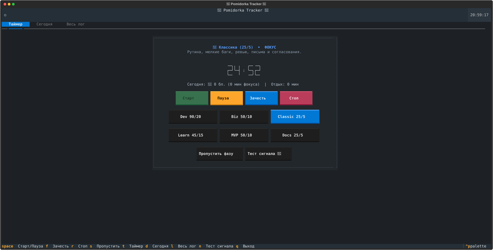
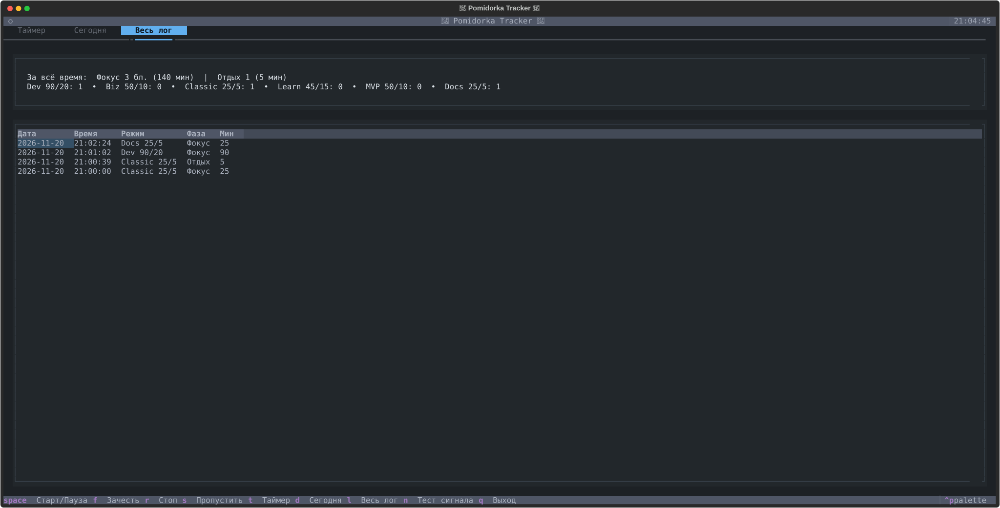
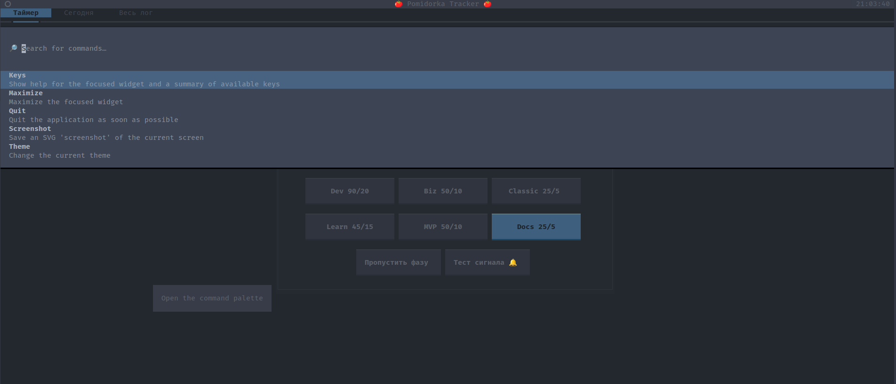
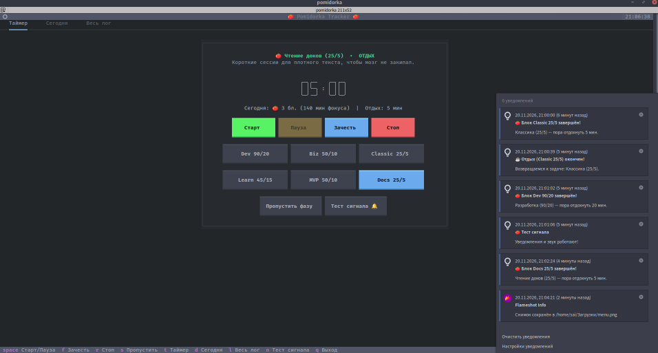

# 🍅 Pomidorka Tracker 🍅


Терминальный (TUI) Pomodoro-трекер на Python и [Textual](https://textual.textualize.io/), заточенный под разработку,
бизнес-задачи, обучение и быстрые MVP-спринты.

---

## Возможности

- **6 режимов работы** с подсказками по фокусу для каждого ритма.
- **Удобный TUI-интерфейс:** крупный таймер, кликабельные кнопки и управление с клавиатуры (включая русскую раскладку).
- **Вкладки со статистикой:**
    - **Таймер** — управление сессией, выбор режима и сводка за текущий день.
    - **Сегодня** — разбивка завершённых блоков по режимам и таблица сессий дня.
    - **Весь лог** — суммарная статистика и полная история за всё время.
- **Локальный JSON-лог:** все завершённые фазы (`work` / `break`) сохраняются в `stats.json` в директории `tmp/`.
- **Нативные уведомления Linux:** десктопные оповещения через `notify-send` и звуковой сигнал через `paplay` (с фолбэком
  на системный бип).

---

## Режимы работы

| Режим       |   Ритм    | Для каких задач                      | На что делать упор                                                   |
|:------------|:---------:|:-------------------------------------|:---------------------------------------------------------------------|
| **Dev**     | `90 / 20` | Разработка, архитектура, рефакторинг | Глубокое погружение без отвлечений. Оптимально 2–3 блока в день.     |
| **Biz**     | `50 / 10` | Аналитика, стратегия, регламенты     | Фокус на одной задаче; 5 мин разминки + 5 мин чек-ин в мессенджерах. |
| **Classic** | `25 / 5`  | Рутина, мелкие баги, ревью, почта    | Закрытие операционки во второй половине дня.                         |
| **Learn**   | `45 / 15` | Изучение нового стека / языка        | Чередование: 1 блок теории → 2 блока кода руками.                    |
| **MVP**     | `50 / 10` | Проверка гипотезы (MVP / PoC)        | Максимум 2–3 цикла. Фокус на «работает или нет», без шлифовки.       |
| **Docs**    | `25 / 5`  | Чтение сложной документации / статей | Короткие сессии, чтобы мозг не «закипал» от плотного текста.         |

---

## Установка и запуск

```bash
git clone https://github.com/ivanitch/pomidorka-tracker.git pomidorka-tracker
cd pomidorka-tracker

# Быстрый запуск без установки проекта (через временный кэш uv)
uv run --no-project --with textual python -m src.pomidorka

# Или полноценная установка зависимостей из директории проекта
uv sync

# Запуск трекера
uv run pomidorka

# Запуск трекера одной командой
pomidorka
```

---

## Горячие клавиши

Все клавиши работают на английской и русской раскладках:

| Клавиша   | Действие                                                  |
|-----------|-----------------------------------------------------------|
| `Space`   | Старт / Пауза                                             |
| `f` (`а`) | Зачесть фазу досрочно (с записью в статистику и сигналом) |
| `r` (`к`) | Стоп (сброс текущей фазы)                                 |
| `s` (`ы`) | Пропустить фазу (без записи в статистику)                 |
| `t` (`е`) | Вкладка «Таймер»                                          |
| `d` (`в`) | Вкладка «Сегодня»                                         |
| `l` (`д`) | Вкладка «Весь лог»                                        |
| `n` (`т`) | Тест сигнала (уведомление и звук)                         |
| `q` (`й`) | Выход                                                     |

---

## Интеграция с Linux (Debian / LMDE / Cinnamon)

### 1. Скрипт-обёртка `~/.local/bin/pomidorka`

```bash
UV_BIN="$(which uv)"
cat << EOF > ~/.local/bin/pomidorka
#!/usr/bin/env bash
cd <путь_к_проекту> && exec "$UV_BIN" run pomidorka
EOF
chmod +x ~/.local/bin/pomidorka
```

*(Убедись, что путь к `uv` совпадает с выводом команды `which uv`.)*

### 2. Иконка помидора 🍅

```bash
mkdir -p ~/.local/share/icons/hicolor/scalable/apps
curl -s https://raw.githubusercontent.com/twitter/twemoji/master/assets/svg/1f345.svg" \
  -o ~/.local/share/icons/hicolor/scalable/apps/pomidorka-tracker.svg
```

### 3. Ярлык в меню приложений

```bash
mkdir -p ~/.local/share/applications
cat << EOF > ~/.local/share/applications/pomidorka.desktop
[Desktop Entry]
Type=Application
Name=Pomidorka Tracker
Comment=Terminal Pomidorka timer for Dev and Business
Exec=$HOME/.local/bin/pomidorka
Icon=$HOME/.local/share/icons/hicolor/scalable/apps/pomidorka-tracker.svg
Terminal=true
Categories=Utility;
Keywords=pomidorka;timer;tracker;focus;
EOF
chmod +x ~/.local/share/applications/pomidorka.desktop
update-desktop-database ~/.local/share/applications
```

### 4. Автозагрузка при входе в систему

```bash
mkdir -p ~/.config/autostart
cp ~/.local/share/applications/pomidorka.desktop ~/.config/autostart/pomidorka.desktop
```

### 5. Автоактивация окна (опционально, Linux / X11)

Чтобы при завершении блока или отдыха окно терминала с трекером автоматически выводилось на передний план, установи
`wmctrl`:

```bash
sudo apt install wmctrl
```

*(Без `wmctrl` трекер продолжит работать, но окно придётся переключать вручную.)*

## Структура проекта и тесты

```text
├── docs/                  # Скриншоты интерфейса для README
│   ├── history.svg
│   ├── main.svg
│   ├── menu.png
│   └── noty.png
├── src/
│   ├── __init__.py
│   ├── pomidorka.py       # TUI-приложение на Textual
│   └── storage.py         # Модели режимов и работа с JSON-логом
├── tests/
│   └── pomidorka_test.py  # Юнит-тесты хранилища и статистики
├── tmp/
│   └── stats.json         # История сессий (создаётся автоматически)
├── pyproject.toml
├── uv.lock
└── README.md
```

Запуск тестов:

```bash
uv run pytest
```

> Файл `stats.json` создаётся автоматически при первом запуске в директории `tmp/` и хранится локально.

---

## UI

Трекер:



Статистика / Журнал событий:



Меню:



Уведомления на рабочем столе:


